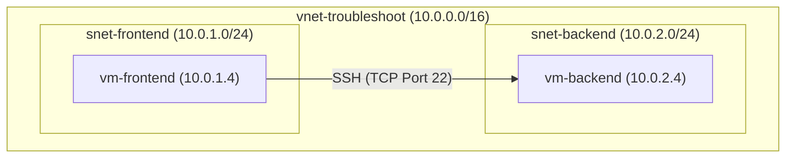
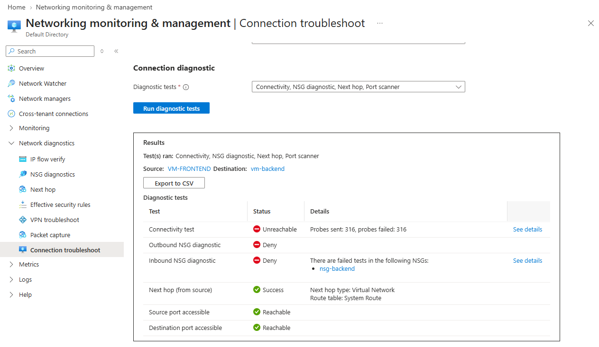
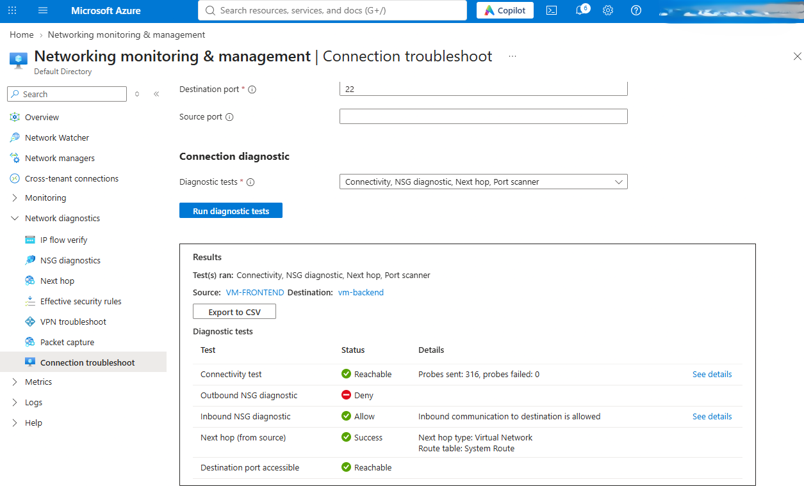

## Project Overview

This repository documents a hands-on lab focused on designing, securing, and troubleshooting a segmented virtual network in Microsoft Azure. The scenario simulates a real-world security incident where inbound SSH communication between a public-facing subnet and a private backend subnet is blocked. Using Azure Network Watcher diagnostics (IP Flow Verify and Connection Troubleshoot), the root cause was isolated to an misconfigured Network Security Group (NSG) rule and successfully repaired to restore secure, segmented communication.
# Security Incident Report: Resolving Azure NSG Block

## 1. Planned Network Architecture Sketch

You can visualize the communication path between our virtual machines below:



Alternatively, here is the text representation:

```text
[ Internet / External Client ]
             │
             ▼ 
┌─────────────────────────────────────────────────────────────┐
│                 vnet-troubleshoot (10.0.0.0/16)             │
│                                                             │
│  ┌─────────────────────────────┐   ┌─────────────────────┐  │
│  │   snet-frontend             │   │ snet-backend        │  │
│  │   (10.0.1.0/24)             │   │ (10.0.2.0/24)       │  │
│  │                             │   │                     │  │
│  │  ┌───────────────┐          │   │  ┌───────────────┐  │  │
│  │  │  vm-frontend  │ ─────────┼──>│  │  vm-backend   │  │  │
│  │  │  (10.0.1.4)   │  Port 22 │   │  │  (10.0.2.4)   │  │  │
│  │  └───────────────┘  (SSH)   │   │  └───────────────┘  │  │
│  └─────────────────────────────┘   └─────────────────────┘  │
└─────────────────────────────────────────────────────────────┘
```

## 2. CIDR Plan Mapping Table

| Resource Name | Subnet / Role | CIDR Block | Valid Private IP Range |
| :--- | :--- | :--- | :--- |
| **vnet-troubleshoot** | Main Virtual Network Address Space | `10.0.0.0/16` | 10.0.0.1 - 10.0.255.254 |
| **snet-frontend** | Frontend/Public-Facing Subnet | `10.0.1.0/24` | 10.0.1.1 - 10.0.1.254 |
| **snet-backend** | Private Backend Subnet | `10.0.2.0/24` | 10.0.2.1 - 10.0.2.254 |# azure-network-troubleshooting-lab
## 3. Incident Symptoms & Initial Detection

* **Symptom:** Inbound SSH connection attempts from the public-facing subnet (**snet-frontend**) to the private backend subnet (**snet-backend**) over **TCP Port 22** are failing.
* **Initial Test:** Running Azure Network Watcher's **Connection troubleshoot** tool returned an **Unreachable** status.
* **Evidence:** The initial failure diagnostic output is captured below:



## 4. Diagnostic Steps & Decision Matrix

To locate the exact drop point, we bypassed traditional host-level troubleshooting and performed network-layer diagnostics using **Azure Network Watcher**:

1. **Diagnostic Tool Used:** `IP Flow Verify`
2. **Test Parameters:**
   * **Protocol:** `TCP`
   * **Direction:** `Inbound`
   * **Source IP:** `10.0.1.4` (vm-frontend)
   * **Source Port:** `Any`
   * **Destination IP:** `10.0.2.4` (vm-backend)
   * **Destination Port:** `22` (SSH)
3. **Diagnostic Result:** The test returned **Access denied**.
4. **Diagnostic Decision:** The tool identified that the traffic was blocked by a specific Network Security Group (NSG) rule: `Deny-SSH-From-Frontend` attached to the network interface of `vm-backend`.
## 5. Incident Remediation & Resolution

To resolve the SSH connectivity block between our VM segments, the following remediation action was taken:

* **Target Resource:** `nsg-backend` (Network Security Group)
* **Identified Blocking Rule:** `Deny-SSH-From-Frontend`
* **Remediation Action:** Updated the action from **Deny** to **Allow**.
* **Scope Retention:** The overall rule scope (limiting traffic source strictly to `10.0.1.4` and destination to `10.0.2.4` on port `22`) was kept completely unchanged to maintain proper network boundaries.

### Proof of Resolution

Following the rule change, a secondary diagnostic test was executed to confirm the network path is fully restored:

1. **Verification Tool:** `Connection troubleshoot`
2. **Path Status:** **Reachable**
3. **Evidence:** 


## 7. Final Connection Verification & Cost Management

### Connection Troubleshoot Results
* **Diagnostic Tool:** `Connection troubleshoot` (Azure Network Watcher)
* **Test Result:** **Reachable**
* **Status Details:** The network path is fully restored and functional. Both the Network Security Group (NSG) and routing layers are successfully permitting traffic from `vm-frontend` to `vm-backend` over TCP Port 22 (SSH).

### Azure Cost-Cleanup & Decommissioning Decision
To practice strong cloud financial hygiene and prevent any unnecessary charges on my subscription, the following actions have been planned:
* **Cleanup Strategy:** Complete deletion of the parent resource group `rg-aznet-troubleshoot` which will automatically decommission all associated virtual machines, disks, interfaces, and virtual networks.
* **Pre-cleanup Verification:** Verified that all portfolio evidence, diagnostics data, and screenshots (`blocked-path.png` and `restored-path.png`) are permanently committed to this public GitHub repository.
* **Cleanup Command:**
  ```bash
  az group delete --name rg-aznet-troubleshoot --yes --no-wait
  ```
## 8. Secret Mission: Diagnosing a Source-Side Block

To understand how source-side outbound security boundaries behave differently from destination-side inbound rules, we conducted an egress troubleshooting scenario:

### Scenario Setup
1. **Egress Boundary:** Created a new Network Security Group named `nsg-frontend` and associated it with the source subnet `snet-frontend`.
2. **Outbound Rule:** Configured a custom outbound security rule named `Deny-SSH-To-Backend`:
   * **Destination Address Range:** `10.0.2.0/24` (Private Backend Subnet)
   * **Destination Port:** `22` (SSH)
   * **Protocol:** `TCP`
   * **Action:** `Deny`
   * **Priority:** `100`

### Diagnostic Execution & Evidence
* **Diagnostic Tool:** `IP Flow Verify` (Azure Network Watcher)
* **Traffic Flow:** Outbound from `vm-frontend` (Source IP: `10.0.1.4`) to `vm-backend` (Destination IP: `10.0.2.4`) on Port 22
* **Initial Test Result:** **Access denied** (Matched Security Rule: `Deny-SSH-To-Backend`)
* **Source-Side Proof:** Since this check evaluated traffic in the **Outbound** direction on the source virtual machine, the diagnostic proves that the packet was blocked and dropped at the egress of `snet-frontend` before ever reaching the backend subnet. The backend's inbound rules were never evaluated because the flow failed at the source.
* **Outbound Diagnostic Block Evidence:**


### Resolution & Final Validation
* **Remediation Action:** Modified the rule action for `Deny-SSH-To-Backend` inside `nsg-frontend` from **Deny** to **Allow**.
* **Post-Remediation Check:** Re-ran the outbound IP Flow Verify diagnostic, which returned **Access allowed** status, proving secure communication is fully restored at the source boundary.
* **Outbound Diagnostic Allowed Evidence:**


